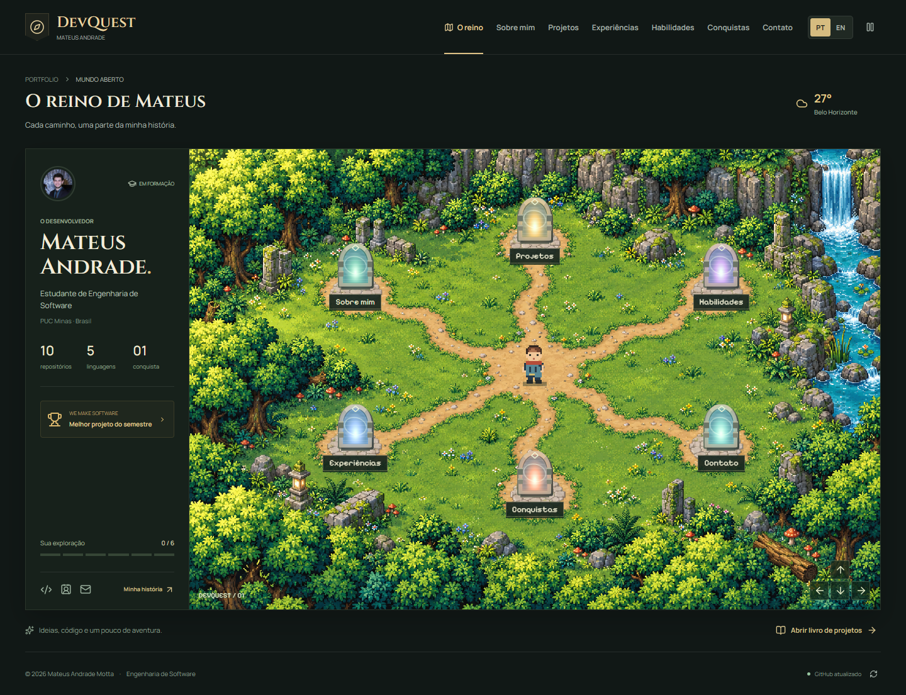
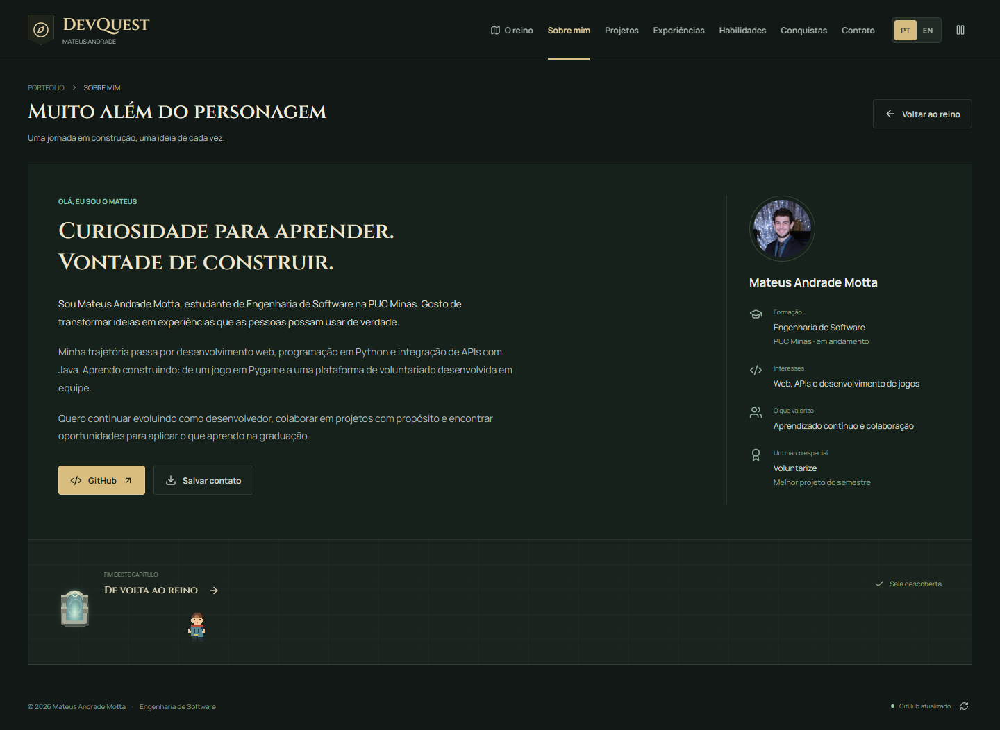
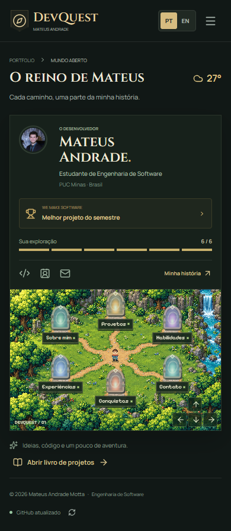
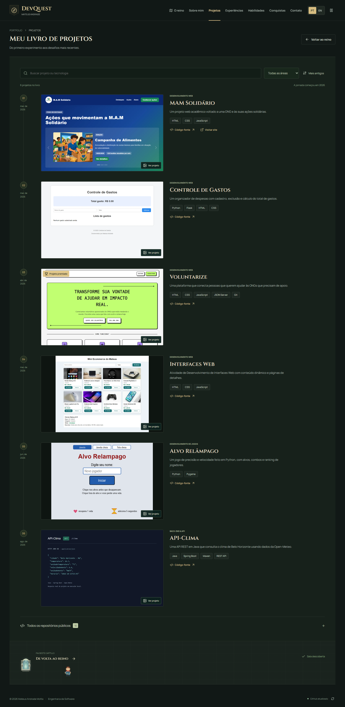
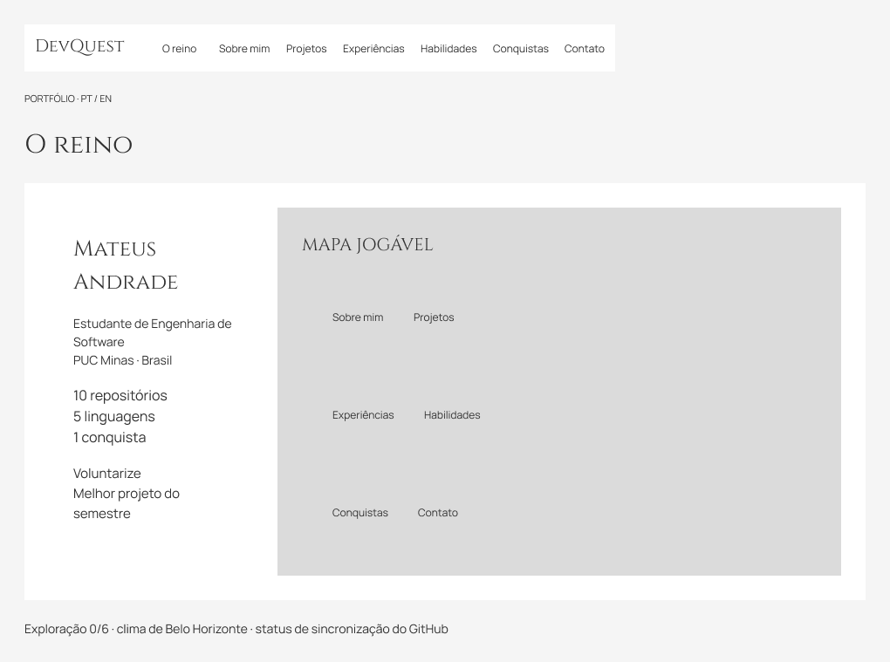
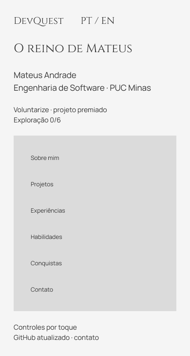
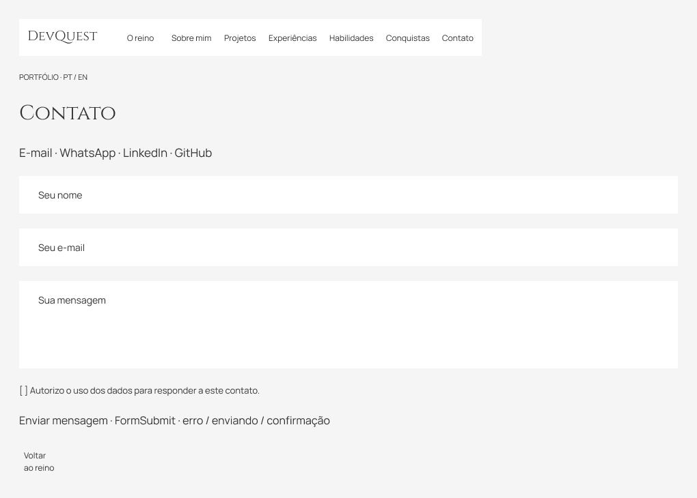

# DevQuest | Portfólio de Mateus Andrade

Portfólio profissional de Mateus Andrade Motta, estudante de Engenharia de Software na PUC Minas. Um RPG em pixel art transforma a apresentação pessoal em uma exploração por seis portais, sem impedir o acesso direto pelo menu.

Desenvolvido para o **Laboratório 01 de Desenvolvimento e Integração de Aplicações Web**.

**[Visitar o portfólio](https://mateusandrade-1809.github.io/MateusAndrade-1809/)** · **[Protótipo no Figma](https://www.figma.com/design/A1ZWmBh1MmZkDaChWUurL0)** · **[Requisitos e pendências](docs/REQUIREMENTS.md)**



## Funcionalidades

- Mapa jogável com personagem animado, seis portais e sala de retorno.
- Navegação direta, histórico do navegador, menu móvel e controle por toque.
- Conteúdo em português e inglês, com idioma salvo localmente.
- Sobre mim: formação, interesses, trajetória e objetivos.
- Seis projetos em linha do tempo, do mais antigo ao mais recente, com descrição, tecnologias, links e capturas reais ampliáveis.
- Pesquisa por projeto/tecnologia, filtros por área e ordenação alternativa.
- Arquivo com todos os repositórios públicos disponíveis pela API do GitHub.
- Experiências acadêmicas e destaque para o **Voluntarize**, melhor projeto do semestre e apresentado no **We Make Software**, conforme relato de Mateus.
- Inventário de habilidades e distribuição real de linguagens por repositório, sem porcentagens fictícias de domínio.
- Contato por e-mail, WhatsApp, LinkedIn, GitHub, arquivo de contato e formulário de mensagem.
- Estados de carregamento, erro, dados em cache e cópia local; preferência por menos animações.

## Tecnologias

| Camada | Tecnologias |
| --- | --- |
| Interface | React 19, TypeScript, CSS responsivo |
| Mundo interativo | Canvas 2D, requestAnimationFrame, Pointer Events |
| Build | Vite 8, saída estática com caminhos relativos |
| Ícones e fontes | Lucide, Manrope, Cinzel, Pixelify Sans, fontes hospedadas localmente |
| Integrações | GitHub REST API, Open-Meteo, FormSubmit |
| Qualidade | TypeScript, ESLint, Node Test Runner, Playwright |
| Publicação | GitHub Pages e GitHub Actions |

Não há banco de dados, autenticação, servidor próprio ou chave secreta no navegador. Serviços externos são consumidos por HTTPS.

## APIs e arquitetura

O navegador carrega a aplicação estática, apresenta os dados curados e consulta os serviços externos:

| Serviço | Uso | Tratamento de indisponibilidade |
| --- | --- | --- |
| [GitHub REST API](https://docs.github.com/en/rest/repos/repos#list-repositories-for-a-user) | Perfil, repositórios públicos, datas e linguagens principais | Cache de uma hora, botão de atualização e snapshot local identificado |
| [Open-Meteo](https://open-meteo.com/en/docs) | Temperatura, condição e dia/noite em Belo Horizonte, refletidos no reino | Clima é opcional; falha não impede navegação |
| [FormSubmit AJAX](https://formsubmit.co/ajax-documentation) | Envio de nome, e-mail e mensagem ao endereço do portfólio | Validação, consentimento, bloqueio de envio duplicado, timeout, preservação do texto e contato direto alternativo |

As consultas de leitura expiram após 12 segundos, o envio após 20 segundos. Trocar o idioma não repete as consultas do GitHub. Apenas dados públicos são buscados; não são incluídos repositórios privados.

**Formulário:** Mateus confirmou a ativação do FormSubmit em 13/10/2026. Uma mensagem real enviada pelo site público retornou HTTP 200 e `success: "true"`. Os estados de erro, ativação pendente e sucesso também têm testes automatizados. O sistema informa o aceite pelo serviço; a entrega na caixa de entrada precisa ser conferida pelo destinatário.

O clima utiliza uma localização fixa, Belo Horizonte; não solicita a localização do visitante. `localStorage` armazena idioma, salas visitadas, preferência de movimento e cache público do GitHub. Os campos do formulário não são gravados em armazenamento local.

## Instalação e execução

Pré-requisitos: Node.js **22.13 ou superior** e npm.

```bash
git clone https://github.com/MateusAndrade-1809/MateusAndrade-1809.git
cd MateusAndrade-1809/portfolio
npm ci
npm run dev
```

Acesse `http://127.0.0.1:3000/`. Se a porta estiver ocupada, o Vite informa a próxima disponível.

Não é necessário criar `.env` para esta versão. Não coloque tokens do GitHub ou credenciais de e-mail no código público.

### Scripts

```bash
npm run dev        # desenvolvimento local
npm run typecheck  # verificação de tipos
npm run lint       # qualidade e acessibilidade do código ativo
npm test           # 11 testes de lógica e integrações simuladas
npm run build      # validação de tipos e build estático
npm start          # prévia do build pronto
npm run snapshot   # atualiza a cópia pública do GitHub
```

### Testes de navegador

```bash
npx playwright install chromium
npm run test:e2e
```

O teste inicia a prévia temporária na porta 4178 e a encerra ao terminar. Para usar o Chrome já instalado, configure `PW_CHANNEL=chrome`. Evidências são gravadas em `work/`, que não é versionada. Os envios de e-mail são interceptados: os testes não enviam spam ao destinatário.

## Estrutura

```text
portfolio/
  app/
    DevQuest.tsx              # entrada da experiência
    globals.css              # identidade e responsividade
    portfolio/
      PortfolioApp.tsx       # navegação, idioma, progresso e layout
      World.tsx              # mapa, personagem e movimento
      RoomExit.tsx           # personagem e portal de retorno
      ProjectJournal.tsx     # linha do tempo, pesquisa e galeria
      Sections.tsx           # sobre, experiências, habilidades e contato
      ContactForm.tsx        # campos, validação e estados de envio
      data.ts                # conteúdo curado PT/EN
      services.ts            # APIs e validações
      hooks.ts               # cache e consultas
  github-pages-src/          # HTML e inicialização do React
  public/
    assets/                  # cenário e avatar
    projects/                # capturas reais dos projetos
    data/github-snapshot.json
    mateus-andrade.vcf
  docs/                      # requisitos, créditos e evidências
  scripts/                   # manutenção do snapshot e build
  tests/                     # lógica e navegador
  vite.pages.config.ts
  package.json
```

O ambiente local antigo contém arquivos de scaffold de outra hospedagem; eles não participam da aplicação atual. A pasta `portfolio/` publicada contém somente o código necessário para a versão estática.

## Publicação

O endereço público permanece o mesmo do perfil. O código-fonte está em `portfolio/` e a saída publicada em `github-pages/`, na raiz do repositório `MateusAndrade-1809`.

O workflow `.github/workflows/portifolio-pages.yml`, na branch `main`, instala as dependências, executa testes e disponibiliza o build como artefato. A publicação acontece pelo workflow `pages.yml` da branch **`gh-pages`**, que é a branch permitida pela proteção do ambiente `github-pages` deste repositório. Alterações somente em `main` não publicam automaticamente: o build validado precisa ser atualizado em `gh-pages`. Não é necessário enfraquecer essa proteção. O workflow da animação de contribuições e o README do perfil são preservados.

## Demonstração e protótipo

| Desktop | Mobile |
| --- | --- |
|  |  |



### Sprint 1: wireframes

O [arquivo editável do Figma](https://www.figma.com/design/A1ZWmBh1MmZkDaChWUurL0) contém sete telas desktop, uma mobile e navegação entre as seções. As oito telas foram revisadas visualmente em 13/10/2026: textos com altura automática, contêineres adaptáveis e rótulos de navegação sem palavras quebradas. O compartilhamento permite visualização por qualquer pessoa com o link.

| Wireframe desktop | Wireframe mobile |
| --- | --- |
|  |  |



### Sprints 2 e 3

Interface funcional, APIs, testes, documentação, capturas e build para publicação. Consulte [REQUIREMENTS.md](docs/REQUIREMENTS.md) para o acompanhamento dos requisitos e as conferências restantes antes da entrega.

## Qualidade

As sete telas foram verificadas em 320, 390 e 1440 pixels. Foram testados idioma, menus, filtros, galeria, movimento, portais, erros de rede e formulário. Veja [TESTING.md](docs/TESTING.md).

## Autoria e créditos

**Mateus Andrade Motta** · Engenharia de Software · PUC Minas.

[GitHub](https://github.com/MateusAndrade-1809) · [LinkedIn](https://www.linkedin.com/in/mateus-andrade-6b20b63ba/) · [E-mail](mailto:mateusandrademotta@gmail.com) · [WhatsApp](https://wa.me/5531994337476)

O Voluntarize e o Alvo Relâmpago são trabalhos de equipe. O prêmio é apresentado como conquista coletiva. Desenvolvimento do portfólio com assistência de IA, conteúdo pessoal confirmado pelo aluno e dados públicos verificáveis.

O cenário foi gerado especificamente para o portfólio. As capturas são dos projetos reais, não simulações visuais. Origem das imagens, fontes e ícones em [ASSETS.md](docs/ASSETS.md). As licenças dos projetos e bibliotecas de terceiros continuam sendo as dos seus respectivos autores; não há concessão adicional de licença sobre esses materiais.
